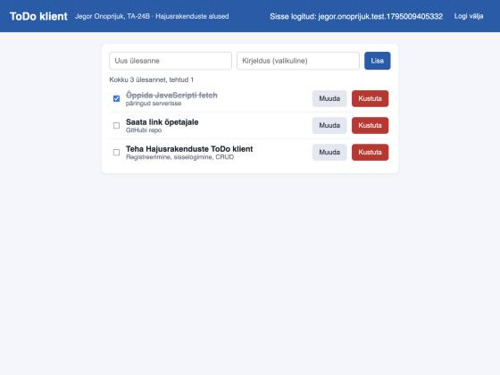

# ToDo klient (Hajusrakenduste alused)

**Autor:** Jegor Onoprijuk, TA-24B  
**Ülesanne:** Harjutus 3 - ülesannete nimekirja klientrakendus (õpetaja Timo Triisa)

Klientrakendus on kirjutatud puhta (vanilla) JavaScriptiga, ilma raamistikuta. Server on õpetaja REST API `http://demo2.z-bit.ee/` (serveri koodi ma ise ei teinud).



## Mida rakendus oskab

| Hinne | Nõue | Minu rakenduses |
|---|---|---|
| 3 | Näitab serverisse salvestatud ülesandeid, saab lisada, checkbox | Jah: `GET /tasks`, `POST /tasks`, checkbox saadab `marked_as_done` |
| 4 | Lisamine, muutmine ja kustutamine (CRUD), token ei ole kõvakodeeritud | Jah: nupud "Muuda" (`PUT /tasks/{id}`) ja "Kustuta" (`DELETE /tasks/{id}`), token tuleb sisselogimisest ja hoitakse `localStorage`-is |
| 5 | Uue kasutaja registreerimine, sisse- ja väljalogimine | Jah: `POST /users` (registreerimine), `POST /users/get-token` (sisselogimine), nupp "Logi välja" |

## Muud detailid

- Kõik päringud käivad ühe funktsiooni `api()` kaudu, mis lisab päise `Authorization: Bearer <token>` ja näitab serveri veateated lehel.
- Kasutaja sisu näidatakse `textContent`-iga, mitte `innerHTML`-iga (XSS vastu).
- Kui server vastab 401, logitakse kasutaja automaatselt välja.

## Kuidas käivitada

Pole vaja midagi paigaldada. Ava `index.html` brauseris, või käivita kaustas:

```bash
python3 -m http.server 8080
```

ja ava `http://localhost:8080`. Server `demo2.z-bit.ee` töötab ainult HTTP kaudu, seetõttu ei tööta rakendus HTTPS-lehelt (nt GitHub Pages).

## Testitud

Käsitsi ja skriptiga läbi proovitud: registreerimine, ülesande lisamine, märkimine tehtuks, muutmine, kustutamine, väljalogimine, uuesti sisselogimine.
